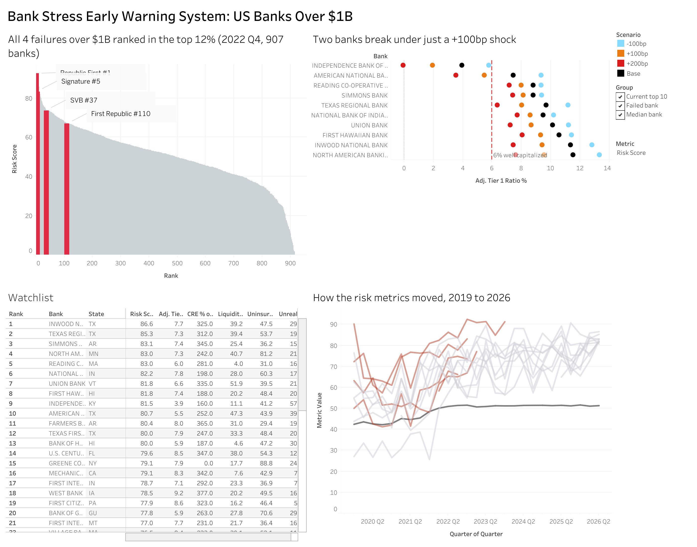

# Bank Stress Early Warning System

A screen that ranks every US bank over $1B in assets on SVB-style risk, tests that ranking against the bank failures since 2023, and stress tests the riskiest banks under interest rate shocks.

**Live dashboard:** [Tableau Public](https://public.tableau.com/app/profile/dhairya.shah6508/viz/BankStressEWS/Dashboard)



## The question

Could public regulatory data have flagged Silicon Valley Bank, Signature Bank and First Republic before they failed? And which banks look most like them today?

## The answer

Yes, with caveats. Using only Call Report data filed before March 2023, the screen ranked all four failures over $1B since 2023 in the top 12% of 907 banks.

| Bank | Failed | Rank at 2022 Q4 (of 907) | Percentile |
|---|---|---|---|
| Republic First | Apr 2024 | 1 | 100.0 |
| Signature | Mar 2023 | 5 | 99.6 |
| Silicon Valley Bank | Mar 2023 | 37 | 96.0 |
| First Republic | May 2023 | 110 | 88.0 |

The top 10 caught 2 of the 4 failures, a precision of 20% against 0.4% for a random pick.

## Current watchlist (2026 Q2)

987 banks scored. The largest names in the top 10 are Simmons Bank ($24.7B, #3) and First Hawaiian Bank ($23.6B, #8). Two of the top 10 fall below well-capitalized levels under a rate shock of just +100bp: Independence Bank of Kentucky and American National Bank of Texas. The full risk committee memo is in [MEMO.md](MEMO.md).

## Recommendation

Prioritize review of the two banks that fail the rate shock, then the two large banks with low liquidity coverage of uninsured deposits. Rerun the screen each quarter as new Call Reports are filed.

## How it works

1. **Data.** FFIEC Call Reports, 27 quarters from 2019 Q4 to 2026 Q2 (128,250 bank-quarters), the FDIC Failed Bank List, and Treasury yields from FRED. Field codes are checked against the Fed MDRM dictionary.
2. **Metrics (SQL in DuckDB).** Six metrics per bank per quarter:
   - Uninsured deposits as a share of total deposits
   - After-tax unrealized securities losses as a share of Tier 1 capital
   - Adjusted Tier 1 leverage: Tier 1 minus after-tax HTM losses, and minus AFS losses for banks that opted out of AOCI, over total assets
   - Liquidity coverage: cash plus unpledged securities over uninsured deposits
   - CRE concentration against the 300% supervisory threshold
   - Quarterly deposit change
3. **Score.** Each metric is ranked against all banks in the same quarter, then the six ranks are averaged with equal weights.
4. **Backtest.** Score as of 2022 Q4, then check where each later failure ranked. A 45-day filing lag keeps the test point in time.
5. **Rate shock.** Duration-based repricing of each securities maturity bucket under +100bp, +200bp and -100bp, with capital recomputed. Durations come from the FRED Treasury curve for government bonds, and from assumed effective durations for mortgage bonds.

## Limitations

- **Small sample.** Only four failures over $1B. The backtest is a sanity check, not proof of predictive power.
- **False positives.** 23 of the top 25 banks at 2022 Q4 did not fail.
- **First Republic ranked only #110.** Its risk was concentrated in uninsured deposits and a large low-rate mortgage book. An equal-weight average dilutes a bank that is extreme on one or two metrics.
- **Duration assumptions.** Mortgage bond durations are assumed, and the model ignores convexity beyond a simple down-shock adjustment.
- **Bank level only.** Call Reports cover the bank, not the holding company.
- **Liquidity metric is narrow.** It counts only cash and unpledged securities, and ignores FHLB and Fed borrowing capacity.
- **Data check.** Pipeline figures for SVB, Signature and First Republic at 2022 Q4 match the public record (SVB: $209.0B assets, $151.6B uninsured deposits, $15.2B HTM unrealized loss). See `06_sanity_check.py`.
- **Methodology change.** After the first run, the capital metric was switched from a risk-weighted basis to a leverage basis, because smaller banks on the community bank leverage ratio do not report risk-weighted assets. The change fixed a data gap in the watchlist; it was not tuned to the backtest. Results before the change were similar: Signature #4, SVB #39, First Republic #129, Republic First #1.

## Repo structure

```
config.py              field codes, thresholds and assumptions
00_verify_fields.py    checks field codes against the MDRM dictionary
01_load.py             loads Call Reports and failures into DuckDB
02_metrics.py          builds metrics (sql/metrics.sql) and the risk score
03_backtest.py         backtest against failures since 2023
04_rate_shock.py       rate shock model and the Excel scenario workbook
05_dashboard_data.py   prepares CSVs for Tableau
06_sanity_check.py     checks pipeline figures against the public record
MEMO.md                one-page risk committee memo
```

## Run it

```
pip install -r requirements.txt
export FRED_API_KEY=your_key
python 00_verify_fields.py
python run_all.py
python 05_dashboard_data.py
```

Download the data first. SETUP.md lists the sources and folder layout. The raw data is not in this repo, because the files are too large.

## Tools

Python (pandas, numpy, fredapi), DuckDB, SQL, Excel, Tableau
